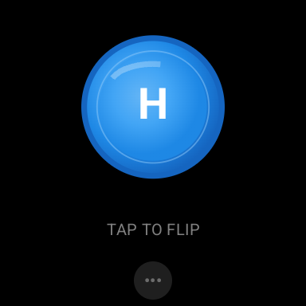
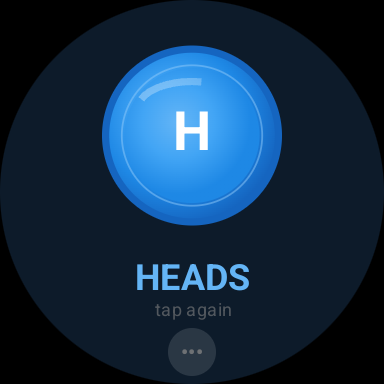
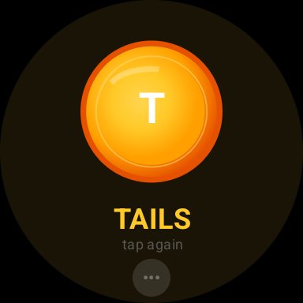
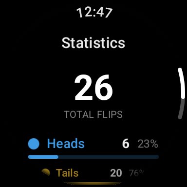

<h1 align="center">Flip</h1>

<p align="center">
  <strong>A premium coin flip experience for Wear OS</strong>
</p>

<p align="center">
  <a href="#features">Features</a> •
  <a href="#screenshots">Screenshots</a> •
  <a href="#architecture">Architecture</a> •
  <a href="#tech-stack">Tech Stack</a> •
  <a href="#getting-started">Getting Started</a> •
  <a href="#building">Building</a>
</p>

<p align="center">
  
  
  
  
</p>

---

## The Problem

Making decisions shouldn't require pulling out your phone. Whether you're settling a friendly debate, deciding who goes first, or just need a quick 50/50 answer, fumbling for your phone breaks the moment.

**Flip** puts instant decision-making on your wrist. One tap. Fair flip. Instant decision.

## The Solution

Flip is a Wear OS app designed with one philosophy: **simplicity is the ultimate sophistication**.

- **One tap** to flip
- **3 seconds** of anticipation
- **Haptic feedback** you can feel
- **Provably fair** randomness

No ads. No accounts. No unnecessary features. Just a beautiful, tactile coin flip.

---

## Features

| Feature | Description                                                                   |
|---------|-------------------------------------------------------------------------------|
| **Realistic 3D Animation** | Physics-based flip with 6 rotations, anticipation wind-up, and landing wobble |
| **Cryptographic Randomness** | Uses `SecureRandom` for provably fair, unbiased results                       |
| **Haptic Feedback** | Two-part vibration pattern on landing, impact followed by settle              |
| **Sound Effects** | Real coin spinning and landing sounds                                         |
| **Statistics Tracking** | Persistent heads/tails count with percentages                                 |
| **Wear OS Tile** | Quick access from your watch face carousel                                    |
| **Standalone App** | Works independently without a phone                                           |

---

## Screenshots

<p align="center">
  
  
  
  
</p>


<p align="center">
  <em>Left to right: Idle state, Heads result, Tails result, Statistics screen</em>
</p>

---

## Video
https://github.com/user-attachments/assets/fd64e49a-91fd-4aa2-a9bd-4a0ac9d90c8c

### State Machine

The coin animation uses a **sealed class state machine** for predictable, testable transitions:

```kotlin
sealed class CoinState {
    data class Idle(val displayedSide: CoinSide)
    data class Anticipating(val startingSide: CoinSide)
    data class Spinning(val startSide: CoinSide, val targetSide: CoinSide)
    data class Decelerating(val targetSide: CoinSide)
    data class Wobbling(val targetSide: CoinSide)
    data class Settled(val result: CoinSide)
}
```

---

## Implementation Decisions

### Cryptographically Secure Randomness

Flip uses `java.security.SecureRandom` instead of standard pseudo-random generators:

```kotlin
private val secureRandom = SecureRandom()

fun random(): CoinSide = if (secureRandom.nextBoolean()) HEADS else TAILS
```

**Why SecureRandom?**
- Sources entropy from OS hardware RNG
- Cryptographically unpredictable
- Industry standard for gaming/gambling applications
- Eliminates any possibility of bias

### True 3D Rotation

Instead of sprite sheets, Flip uses real 3D rotation via `graphicsLayer`:

```kotlin
Modifier.graphicsLayer {
    rotationX = animatedRotation  // Primary flip axis
    rotationZ = wobbleRotation    // Landing wobble
    cameraDistance = 20f * density // 3D perspective
}
```

**Benefits:**
- Smooth 60fps animation
- Dynamic face visibility based on rotation angle
- Realistic perspective distortion
- Smaller APK size

### Canvas-Drawn Coin Faces

Coins are drawn procedurally for resolution independence:

```kotlin
Canvas(modifier) {
    drawCircle(brush = metallicGradient, radius = radius * 0.92f)
    drawCircle(color = ringColor, style = Stroke(width = 2f))
    drawText(textLayoutResult, topLeft = center)
    drawArc(brush = highlightGradient, startAngle = 200f, sweepAngle = 80f)
}
```

### Animation Timing

Carefully tuned for psychological impact:

| Phase | Duration | Purpose |
|-------|----------|---------|
| Anticipation | 180ms | Wind-up creates tension |
| Spinning | 2000ms | Builds anticipation |
| Deceleration | 450ms | Signals ending |
| Wobble | 400ms | Satisfying landing |

---

## Tech Stack

| Category | Technology |
|----------|------------|
| **Language** | Kotlin 2.0 |
| **UI Framework** | Jetpack Compose for Wear OS |
| **Architecture** | MVVM + Clean Architecture |
| **Randomness** | java.security.SecureRandom |
| **State Management** | StateFlow |
| **Persistence** | DataStore Preferences |
| **Animation** | Compose Animation APIs |
| **Haptics** | Android VibrationEffect |
| **Audio** | SoundPool |
| **Tile** | Wear Tiles + Horologist |
| **Build** | Gradle 9.0 + Kotlin DSL |
| **Minification** | R8 |

---

## Getting Started

### Prerequisites

- Android Studio Ladybug (2024.2.1) or newer
- Wear OS emulator or physical device (API 28+)
- JDK 11+

### Clone & Build

```bash
# Clone the repository
git clone https://github.com/joelkanyi/Flip.git
cd Flip

# Build debug APK
./gradlew :wear:assembleDebug

# Install on connected Wear OS device
./gradlew :wear:installDebug
```

### Run on Emulator

1. Open Android Studio
2. Create a Wear OS emulator (API 30+ recommended)
3. Run the `wear` configuration

---

## Building

### Debug Build

```bash
./gradlew :wear:assembleDebug
# Output: wear/build/outputs/apk/debug/wear-debug.apk
```

### Release Build

1. **Create a keystore** (first time only):
```bash
mkdir -p keystore
keytool -genkey -v -keystore keystore/release.keystore \
  -alias flip -keyalg RSA -keysize 2048 -validity 10000
```

2. **Create `keystore.properties`** in project root:
```properties
storeFile=keystore/release.keystore
storePassword=your_store_password
keyAlias=flip
keyPassword=your_key_password
```

3. **Build signed APK**:
```bash
./gradlew :wear:assembleRelease
# Output: wear/build/outputs/apk/release/wear-release.apk
```
---

## Contributing

Contributions are welcome!

1. Fork the repository
2. Create a feature branch (`git checkout -b feature/amazing-feature`)
3. Commit your changes (`git commit -m 'Add amazing feature'`)
4. Push to the branch (`git push origin feature/amazing-feature`)
5. Open a Pull Request

---

## License

```
MIT License

Copyright (c) 2026 Joel Kanyi

Permission is hereby granted, free of charge, to any person obtaining a copy
of this software and associated documentation files (the "Software"), to deal
in the Software without restriction, including without limitation the rights
to use, copy, modify, merge, publish, distribute, sublicense, and/or sell
copies of the Software, and to permit persons to whom the Software is
furnished to do so, subject to the following conditions:

The above copyright notice and this permission notice shall be included in all
copies or substantial portions of the Software.

THE SOFTWARE IS PROVIDED "AS IS", WITHOUT WARRANTY OF ANY KIND, EXPRESS OR
IMPLIED, INCLUDING BUT NOT LIMITED TO THE WARRANTIES OF MERCHANTABILITY,
FITNESS FOR A PARTICULAR PURPOSE AND NONINFRINGEMENT. IN NO EVENT SHALL THE
AUTHORS OR COPYRIGHT HOLDERS BE LIABLE FOR ANY CLAIM, DAMAGES OR OTHER
LIABILITY, WHETHER IN AN ACTION OF CONTRACT, TORT OR OTHERWISE, ARISING FROM,
OUT OF OR IN CONNECTION WITH THE SOFTWARE OR THE USE OR OTHER DEALINGS IN THE
SOFTWARE.
```
